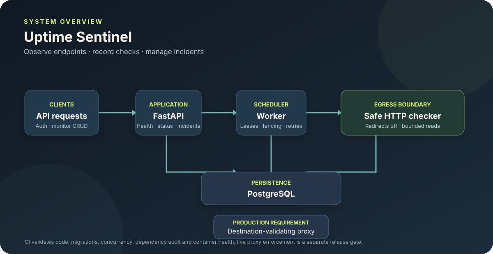
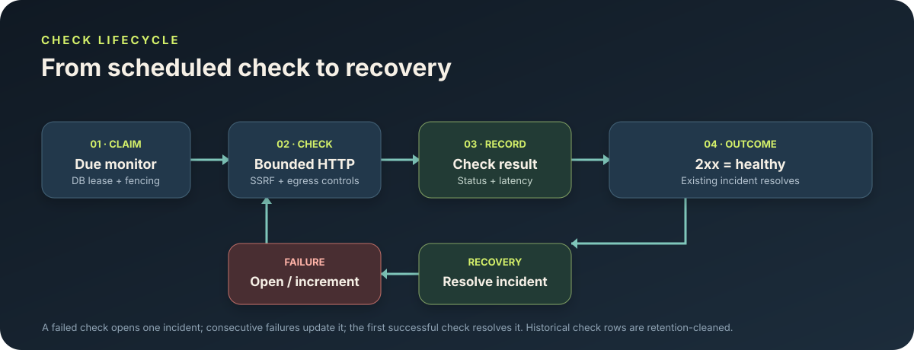

<div align="center">

# Uptime Sentinel

**Know when your endpoints fail. Know when they recover.**

A FastAPI uptime-monitoring service with scheduled HTTP/HTTPS checks, latency history, incident tracking, a public read-only status page, and a PostgreSQL-backed worker.

[](https://github.com/vankudothuadhinaik/uptime-sentinel/actions/workflows/ci.yml)
[](https://codecov.io/gh/vankudothuadhinaik/uptime-sentinel)


[Architecture](#architecture) · [Features](#features) · [Quick start](#quick-start) · [Quality gates](#quality-and-integrations) · [Security](#security-model) · [Release checklist](#production-release-gates)

</div>

---

## At a glance

- **API:** FastAPI endpoints for authentication, monitor management, health, and public status.
- **Scheduler:** continuous worker with PostgreSQL-backed claims, leases, and fencing to reduce duplicate/stale work.
- **Monitoring:** bounded HTTP response reads, latency/failure history, incident open/increment/recovery lifecycle.
- **Security:** application-side SSRF validation, redirects disabled, production egress-proxy requirement, no forwarding of user credentials.
- **Operations:** Alembic migrations, Docker Compose, GitHub Actions, Codecov, optional Sentry, and optional Doppler developer workflow.

> **Project status:** this is a GitHub portfolio project with a local Docker Compose demo; paid hosting is not required. The [GitHub Actions run history](https://github.com/vankudothuadhinaik/uptime-sentinel/actions) records standard checks and Compose smoke-test results; consult individual runs for the exact commit and jobs verified. The proxy-authentication fail-closed fix is merged in [PR #6](https://github.com/vankudothuadhinaik/uptime-sentinel/pull/6). The external proxy integration job is an explicit opt-in on manual workflow dispatch and requires six fixture URL/configuration secrets for infrastructure you control; ordinary CI uses deterministic local proxy fixtures. The external job is not claimed as passed. Render deployment is out of scope. Never use the public test proxy for sensitive or production traffic.

## Architecture



The API and worker share PostgreSQL. Workers claim due monitors with lease/fencing protection, perform bounded HTTP checks, and persist results and incident transitions. In production, the outbound destination must be revalidated by a controlled egress proxy at connection time to address DNS-rebinding risks that application-only validation cannot eliminate.

**Operational metrics:** `GET /metrics` emits Prometheus text-format gauges for overdue checks, expired leases, open incidents, and retained failed-check history. The retained failed-check metric is a current-history gauge, not a cumulative counter. Protect this endpoint at the network/ingress layer before exposing it publicly. Scheduler exceptions are structured worker logs, not a durable cross-process counter.

**Rate-limit storage:** by default, SlowAPI uses in-process `memory://` storage, which is suitable for the single-process local demo only. For multiple API replicas, set `RATE_LIMIT_STORAGE_URI=redis://redis:6379/1` (or the reachable Redis URL for your deployment) so counters are shared. Redis is optional for the base scheduler/API architecture; it is used for shared rate limits only when explicitly configured. Configure authentication/TLS and network access appropriately for deployed Redis.

## Monitor and incident lifecycle



A failing check opens an incident once; subsequent failures update the same incident; the first successful check resolves it. Check history older than `RESULT_RETENTION_DAYS` (default 30) is purged by the worker while incident records remain.

## Features

| Area | Implementation |
|---|---|
| Authentication | Argon2 password hashing and signed JWTs |
| Ownership | Private monitors, checks, and incidents scoped to the authenticated owner |
| Endpoint checks | HTTP/HTTPS, timeouts, latency, bounded response streaming |
| Incident lifecycle | Open on first failure, increment on consecutive failures, resolve on recovery |
| Scheduling | PostgreSQL row locks, lease expiry, lease tokens/fencing |
| SSRF defenses | Resolve and reject non-global targets, reject URL credentials, disable redirects |
| Production guardrails | Require PostgreSQL, a strong JWT secret, and `EGRESS_PROXY_URL` |
| Observability | Optional privacy-conscious Sentry integration |
| Developer workflow | Optional Doppler workflow documentation; Doppler is not required by CI or runtime |
| Operations | Health endpoints, Alembic migrations, Docker Compose smoke test, retention cleanup |

## Quick start

Requirements: Python 3.12+, PostgreSQL for production-like use, and Docker Compose if you want to run the container stack.

### Windows PowerShell

```powershell
py -m venv .venv
.\.venv\Scripts\Activate.ps1
pip install -e ".[dev]"
Copy-Item .env.example .env
```

Set local development values in `.env`, then run migrations and the API:

```powershell
alembic upgrade head
uvicorn app.main:app --reload
```

Open [http://127.0.0.1:8000/docs](http://127.0.0.1:8000/docs).

### Example: register and create a monitor

```powershell
$token = (Invoke-RestMethod -Method Post http://127.0.0.1:8000/auth/register -ContentType application/json -Body '{"email":"dev@example.com","password":"correct horse battery staple"}').access_token
$headers = @{ Authorization = "Bearer $token" }
$monitor = Invoke-RestMethod -Method Post http://127.0.0.1:8000/monitors -Headers $headers -ContentType application/json -Body '{"name":"Example","url":"https://example.com","interval_seconds":60,"timeout_seconds":10,"public":true}'
$monitor
Invoke-RestMethod -Method Post "http://127.0.0.1:8000/monitors/$($monitor.id)/check" -Headers $headers
```

Use disposable development credentials only. Never reuse example passwords or commit real secrets.

### Docker Compose

1. Copy `.env.example` to `.env`.
2. Configure a local PostgreSQL URL and a development-only JWT secret.
3. For a local development demo, `EGRESS_PROXY_URL` may be blank and checks use direct outbound connections. **Production must use a private, controlled egress proxy**; never point production at an arbitrary public proxy.
4. Run:

```powershell
docker compose up --build
```

For a disposable end-to-end smoke test, use `.\scripts\compose-smoke.ps1`. It validates Compose configuration, builds and starts the services, waits for `/health/live`, then exercises readiness, registration/login, monitor creation, worker check persistence, and public status before tearing down the test stack. The smoke test checks `https://example.com`, so outbound HTTPS access is required.

## Quality and integrations

### Continuous integration

The [GitHub Actions workflow](.github/workflows/ci.yml) runs:

- Dependency consistency check (`pip check`)
- Ruff lint and formatting checks
- mypy type checking
- PostgreSQL-backed concurrency and lease/fencing tests
- pytest with coverage output
- Codecov coverage upload
- Python compilation
- pip-audit dependency vulnerability scan
- PostgreSQL and SQLite migration upgrade/downgrade round trips
- Docker Compose build/startup and API liveness smoke test
- Compose end-to-end smoke: registration/login, monitor creation, worker check persistence, and public status
- Deterministic local proxy security regressions; the external controlled-proxy suite remains opt-in

PR #14 is open from `hardening/ops-metrics-proxy-limits-recovery`; the latest pushed commit is `6bec54c`. CI run [#325](https://github.com/vankudothuadhinaik/uptime-sentinel/actions/runs/40924701371) passed for parent commit `4adefa5`; the latest-SHA checks page is still loading and has no completed result. The external controlled-proxy job remains opt-in and is not claimed as passed.

[](https://github.com/vankudothuadhinaik/uptime-sentinel/actions/workflows/ci.yml) · [All workflow runs](https://github.com/vankudothuadhinaik/uptime-sentinel/actions)

### Codecov

Coverage XML is generated by pytest-cov and uploaded with `codecov/codecov-action@v5`. The workflow requires the upload step to succeed. Coverage badges and reports are supplied by Codecov and may take time to refresh.

[Open Codecov report](https://codecov.io/gh/vankudothuadhinaik/uptime-sentinel)

### Sentry and Doppler

- **Sentry is optional.** Leave `SENTRY_DSN` empty to disable it. When configured, the integration disables default PII and request-body collection.
- **Doppler is optional.** See [DOPPLER.md](DOPPLER.md) for the Windows PowerShell development workflow and the existing development configuration. It is not required by the app or public CI.
- **Render:** deployment is not required for this portfolio project. The [historical deployment notes](docs/RENDER_DEPLOYMENT.md) are retained for context only; no paid deployment blueprint is included.

### Other engineering tools

The repository also uses Alembic, PostgreSQL, Docker Compose, Ruff, mypy, pytest/pytest-cov, and pip-audit. Tool badges identify integrations/configuration, not proof of a production deployment or independent security certification.

## Security model

- Production startup rejects the built-in development JWT secret and secrets shorter than 32 characters. Use a unique, randomly generated secret from a secret manager.
- Private monitor, check, and incident queries are ownership-scoped.
- Authentication endpoints are rate-limited; monitor counts, interval, timeout, pagination, and request fields are bounded.
- SSRF checks resolve DNS answers and reject non-global addresses, including private, loopback, link-local, reserved, multicast, metadata-range, and IPv4-mapped IPv6 addresses.
- URL credentials are rejected; redirects are not followed; user-supplied headers/credentials are not forwarded.
- Response bodies are streamed only up to `MAX_RESPONSE_BYTES`; errors are bounded and credentials are not logged.
- **Important limitation:** DNS can change between application validation and the HTTP connection. Production therefore requires `EGRESS_PROXY_URL` to point to a private, controlled proxy that independently validates the actual destination at connection time. Do not use an arbitrary public proxy.

## Current P0 reliability/security hardening (PR #14)

The current pull-request branch adds a shared lease path for manual and scheduled checks, a wall-clock deadline spanning streamed HTTP bodies, strict PATCH null validation, fenced result persistence, one-open-incident database enforcement, concurrent quota serialization, stable bounded incident/check pagination, and regression coverage.

The current branch also corrects the retained failed-check metric to a gauge name, covers metric values/types and proxy overload/oversized-header responses, adds allowed-forwarding socket coverage, disposes test engines, and makes the PostgreSQL concurrency test deterministic on persistent databases.

**Remaining external gate:** the opt-in controlled-proxy test is blocked because independently controlled fixture URLs/configuration are not available. Do not treat this as evidence that DNS rebinding, private-IP blocking, redirects, and invalid TLS have been verified against an externally operated proxy. PR #14 remains open; no release tag has been created.

## Verification status

Local verification passed; CI run #325 passed for parent commit `4adefa5`. The latest commit `6bec54c` still needs its own completed workflow result.

| Check | Verified result |
|---|---|
| `checks` job | **Passed** — dependencies, lint, formatting, type checking, PostgreSQL concurrency, tests/coverage, Codecov upload, compile, dependency audit, and migration round trips |
| `compose-smoke` | **Passed** — Compose configuration, container build/start, API health, registration/login, monitor creation, worker check persistence, and public status |
| `proxy-local-integration` | **Passed** — controlled local proxy security tests covering address policy, DNS failures/mixed answers, connection pinning, redirects, authentication, unsupported requests, and TLS verification |
| `proxy-integration` | **Skipped** — optional independently operated proxy fixtures/secrets are not configured; this is not a security pass for any external/production proxy |
| Local Docker Compose end-to-end demo (2026-10-29) | **Passed** — isolated stack; registration/login, monitor creation, worker processing, persisted HTTP 200 result, and public status |
| Render API/worker deployment | **Not deployed or required** |

PR #14 is not merged. The external `proxy-integration` job remains opt-in and blocked until controlled fixture infrastructure exists. These checks validate the repository's local proxy implementation and deterministic fixtures, not an independently operated production proxy or production readiness.

## Production-only release gates (out of scope for this portfolio project)

- [ ] Provision an isolated, access-controlled egress proxy that validates the actual destination IP at connection time and enforces IPv4/IPv6, private/loopback/link-local/metadata, DNS-rebinding, redirect, and TLS policy.
- [ ] Only if you operate a controlled proxy and deterministic fixtures, configure these GitHub Actions repository secrets (they are fixture URLs/configuration, not values to invent): `EGRESS_PROXY_TEST_URL`, `EGRESS_PUBLIC_URL`, `EGRESS_PRIVATE_URL`, `EGRESS_REBIND_URL`, `EGRESS_REDIRECT_URL`, `EGRESS_BAD_TLS_URL`.
- [ ] Manually dispatch the workflow with `run_external_proxy_tests` checked and verify `proxy-integration` actually runs and passes. Inspect proxy enforcement logs; generic network errors and arbitrary 5xx responses are not proof of destination blocking.
- [ ] Configure production `DATABASE_URL`, a unique `JWT_SECRET` of at least 32 characters, and the private `EGRESS_PROXY_URL` for both API and worker.
- [ ] Apply migrations once through a controlled release step.
- [ ] Verify `/health/live`, `/health/ready`, registration, monitor creation, worker execution, result/incident persistence, recovery after restart, and retention cleanup.
- [ ] Record actual proxy test results, deployment IDs/URLs, migration result, and end-to-end observations in [VERIFICATION_REPORT.md](VERIFICATION_REPORT.md).

**Do not label this project production-ready until every applicable release gate is genuinely verified.** Standard CI and unit tests cannot replace a real controlled egress-proxy test or deployed end-to-end smoke test.

## Useful links

- [API docs (local)](http://127.0.0.1:8000/docs)
- [GitHub Actions](https://github.com/vankudothuadhinaik/uptime-sentinel/actions)
- [Codecov](https://codecov.io/gh/vankudothuadhinaik/uptime-sentinel)
- [Render runbook](docs/RENDER_DEPLOYMENT.md)
- [Egress proxy test plan](EGRESS_PROXY_TESTING.md)
- [Release checklist](RELEASE_CHECKLIST.md)
- [Verification report](VERIFICATION_REPORT.md)
- [Doppler workflow](DOPPLER.md)

---

<div align="center">

**Built around a simple rule: prove the failure path, not just the happy path.**

</div>
