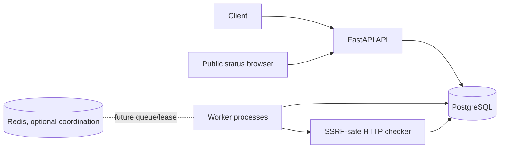

# Uptime Sentinel

Uptime Sentinel is a focused FastAPI service for developers and small teams to monitor HTTP/HTTPS endpoints, record latency and failures, track incidents, and publish a minimal read-only status page.

## Architecture



`worker.py` polls due monitors and uses PostgreSQL row locks plus `lease_until` to claim work. Multiple PostgreSQL-backed workers can therefore avoid duplicate claims; SQLite is intended only for local tests. Redis is included for a future queue/coordination layer but is not silently required by the current worker.

## Quick start

```powershell
py -m venv .venv
.\.venv\Scripts\Activate.ps1
pip install -e ".[dev]"
Copy-Item .env.example .env
alembic upgrade head
uvicorn app.main:app --reload
```

Open `http://127.0.0.1:8000/docs`. Example requests:

```powershell
$token = (Invoke-RestMethod -Method Post http://127.0.0.1:8000/auth/register -ContentType application/json -Body '{"email":"dev@example.com","password":"correct horse battery staple"}').access_token
$headers = @{ Authorization = "Bearer $token" }
Invoke-RestMethod -Method Post http://127.0.0.1:8000/monitors -Headers $headers -ContentType application/json -Body '{"name":"Example","url":"https://example.com","interval_seconds":60,"timeout_seconds":10,"public":true}'
```

For Docker Compose, copy `.env.example` to `.env`, set a unique production `JWT_SECRET`, set `DATABASE_URL=postgresql+psycopg://uptime:<password>@postgres:5432/uptime_sentinel`, and set `EGRESS_PROXY_URL` to a controlled proxy that performs destination validation. Then run `docker compose up --build`. Redis is health-checked for deployment consistency but is not used by the current worker.

For a disposable local smoke test, configure test-only values in `.env` and run `.\scripts\compose-smoke.ps1`. It validates Compose configuration, builds the images, waits for `/health/live`, prints service logs, and tears the test stack down afterward.

Sentry is optional. Leave `SENTRY_DSN` empty to keep error monitoring disabled;
when configured through a deployment secret manager, the integration disables
default PII and request-body collection. See [DOPPLER.md](DOPPLER.md) for the
optional Windows PowerShell workflow using the existing `uptime-sentinel`
development configuration. Doppler is not required by the application or
public CI.

## CI status and release gate

Always use the [GitHub Actions workflow page](https://github.com/vankudothuadhinaik/uptime-sentinel/actions/workflows/ci.yml) for the live status; this README is a snapshot, not a live CI indicator.

- **Latest verified CI run:** [run #82](https://github.com/vankudothuadhinaik/uptime-sentinel/actions/runs/40659958443), commit `092e18e214e038a50c1757c4d7f28e473faa4dc5`. The `checks` job passed, including dependency validation, Ruff, formatting, mypy, PostgreSQL concurrency, tests/coverage, compilation, dependency audit, and PostgreSQL/SQLite migration round trips. The Docker Compose smoke test also passed, including container build/startup and API health check. The `codecov/patch` check passed. The controlled proxy integration was skipped because its fixture secrets were not configured.
- **Proxy integration:** skipped in run #82 because the controlled proxy fixture secrets were not configured. Skipped is not passed.
- **Render deployment:** the PostgreSQL database is available in the dedicated Uptime Sentinel workspace. The API and worker are not yet verified as deployed.
- **Production readiness:** not complete until a controlled destination-validating egress proxy passes the integration tests and the deployed API/worker are smoke-tested.

### Required before production deployment

1. Confirm the complete CI workflow, including Docker Compose smoke, passes on the latest commit.
2. Provision an isolated, access-controlled forward proxy that independently validates destination IPs at connection time, prevents DNS-rebinding and unsafe redirects, and logs rejected destinations. Do not use a public/general-purpose proxy.
3. Configure the six repository Actions secrets documented in [EGRESS_PROXY_TESTING.md](EGRESS_PROXY_TESTING.md): `EGRESS_PROXY_TEST_URL`, `EGRESS_PUBLIC_URL`, `EGRESS_PRIVATE_URL`, `EGRESS_REBIND_URL`, `EGRESS_REDIRECT_URL`, and `EGRESS_BAD_TLS_URL`.
4. Manually dispatch the CI workflow and verify the proxy integration passes against the real controlled proxy. Inspect the proxy's enforcement logs; mocked transports are not a substitute.
5. Deploy the API and worker in the dedicated Uptime Sentinel Render workspace with PostgreSQL, a unique randomly generated `JWT_SECRET` of at least 32 characters, TLS termination, a controlled destination-validating egress proxy, and managed secrets. Never commit production secrets.
6. Apply migrations once per release, then verify `/health/live` and `/health/ready`, registration, monitor creation, worker scheduling, and database persistence.
7. Confirm `RESULT_RETENTION_DAYS` matches policy and monitor the worker's daily retention-cleanup logs. Expired check samples are deleted; incident records are retained.

Do not describe the current branch as fully production-ready until all of these release gates are verified. A passing unit/CI checks job alone does not prove the real egress proxy or production deployment is secure.

## Deployment

See the [Render deployment runbook](docs/RENDER_DEPLOYMENT.md) for the API, worker, PostgreSQL, environment-variable, migration, and production release checklist. Deploy only in the dedicated Uptime Sentinel workspace. The real controlled egress-proxy integration remains a mandatory security gate before production traffic.

## Data model and incident policy

`users` own `monitors`; each monitor has `check_results` and `incidents`, plus UTC scheduling and lease timestamps. A non-2xx response, timeout, request failure, unsafe target, or redirect is down. The first consecutive down result opens one incident; later failures increment it; the first 2xx result resolves it. Check results older than `RESULT_RETENTION_DAYS` (default 30) are purged daily by the worker; incident records remain available. Monitor cleanup logs and schedule maintenance independently if multiple workers or data volume make per-worker cleanup inefficient.

## Security

- Argon2 password hashing and signed JWTs. When `APP_ENV=production`, startup rejects the built-in development JWT secret and secrets shorter than 32 characters; use a unique random secret from a secret manager.
- Every private monitor, check, and incident query is scoped by authenticated owner.
- Monitor count, interval, timeout, pagination, and body fields are bounded. Authentication endpoints have application rate limits.
- SSRF checks resolve every DNS answer and reject any address that is not globally routable, including private, loopback, link-local, reserved, multicast, metadata-range, and IPv4-mapped IPv6 addresses. Credentials in URLs are rejected; redirects are treated as down and never followed.
- DNS rebinding between validation and the HTTP client's connection remains a limitation of the application layer. Production startup now fails unless `EGRESS_PROXY_URL` is configured; the proxy must revalidate every destination and enforce public-only egress. Direct production egress is not supported.
- Monitoring requests do not forward user headers or credentials. Response bodies are streamed only up to `MAX_RESPONSE_BYTES`; error messages are bounded and credentials are not logged.

## Verification

```powershell
ruff check .
pytest -q
python -m compileall -q app tests migrations
$env:DATABASE_URL = "sqlite:///./migration_check.db"
alembic upgrade head
alembic downgrade base
alembic upgrade head
```

The test suite uses isolated in-memory SQLite data and mocked HTTP transports. It covers authentication, ownership isolation, invalid JWTs, pagination bounds, validation, public status output, health endpoints, production JWT-secret validation, interval scheduling, paused/leased monitors, mixed DNS answers, mapped IPv6, redirects, bounded response streaming, proxy selection, and incident recovery. `tests/test_postgres_concurrency.py` runs when `POSTGRES_TEST_URL` is configured and verifies concurrent PostgreSQL claims, expiry recovery, and fencing; it is skipped locally when PostgreSQL is unavailable. `tests/test_egress_proxy_integration.py` is opt-in and requires a controlled proxy plus explicit fixture endpoints for private-IP, DNS-rebinding, redirect, and invalid-TLS cases.

## Operations and limitations

Use PostgreSQL, TLS termination, secret management, request rate limiting at the edge, structured JSON logs, metrics, an egress proxy or pinned transport, and a cleanup job in production. The included PostgreSQL lease is suitable for a small deployment but should be load-tested and monitored. This repository is a portfolio-quality reference implementation, not a claim of complete production readiness or a deployment.
